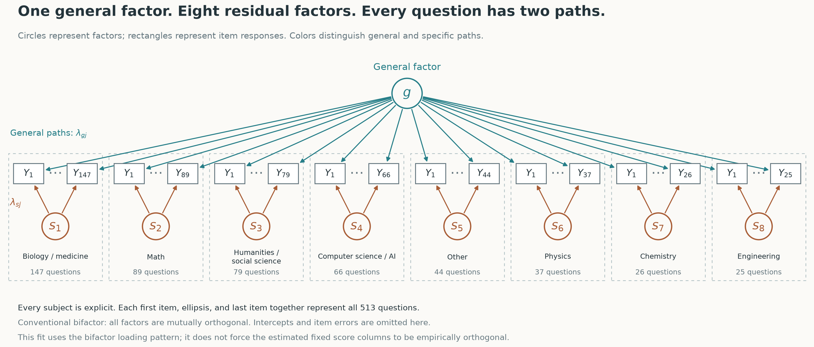
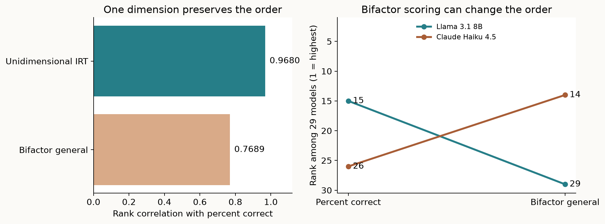
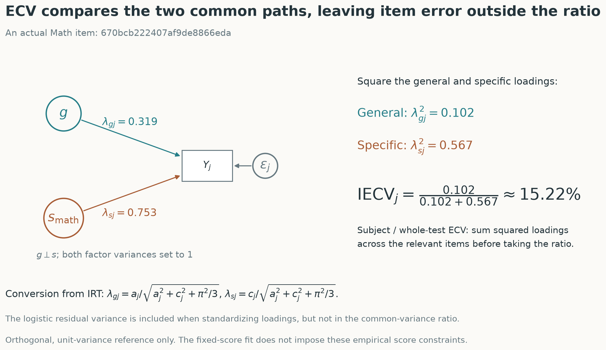
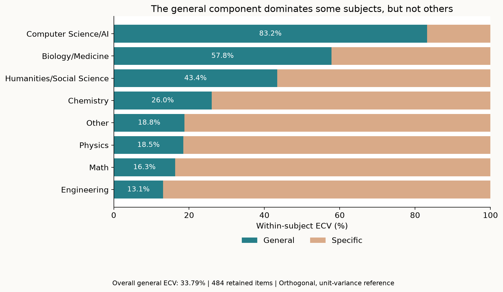
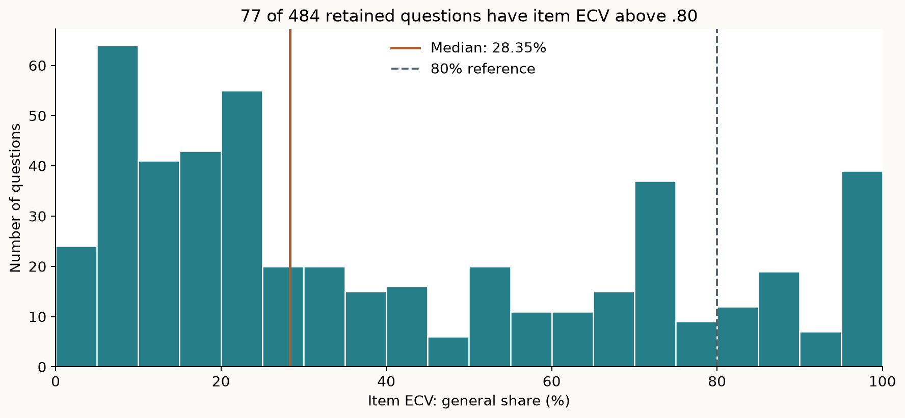

# Humanity’s Last Exam Has a Scoring Problem. Percent Correct Hides It.

*First draft · Preston Botter · October 29, 2026*

*A follow-up on what happens when an AI benchmark’s single score meets a unidimensionality check.*

Llama did not change its answers. It fell 14 places anyway.

In [my previous article](https://benchmarkanatomy.substack.com/p/i-re-scored-humanitys-last-exam-llama), I rescored Humanity’s Last Exam using three item response theory models. The analysis uses a 513-question, text-only, multiple-choice subset of the exam. Llama 3.1 8B Instruct ranked 15th by percent correct and 29th on the bifactor model’s general score. Claude Haiku 4.5 moved the other way, from 26th to 14th.

Those movements raised a question: **how much of this test’s modeled common signal actually belongs to the general factor?**

I have now calculated explained common variance, or ECV, from that fitted bifactor model. Under the conventional factor-scaling assumptions described below, the overall value is **33.79%**, calculated over 484 retained questions.[^ecv-items] That looks awful beside the values commonly discussed as reassuring evidence for a predominantly single-dimensional measure. It is also a conditional diagnostic from a research implementation, requiring more care than a headline number suggests.

My reading is that Humanity’s Last Exam has a scoring-model problem worth taking seriously: its percentage is being asked to support an interpretation of general capability that needs considerably more evidence.

Percent correct gives each observed answer one vote. A correct engineering answer contributes the same amount as a correct philosophy answer. It makes no distinction between an answer reflecting broad capability and one reflecting an additional subject-specific strength. Subjects with more questions also contribute more votes.

That arithmetic is perfectly legitimate for describing success on a specified question set. Percent correct does not, by itself, mathematically assume unidimensionality. The stronger assumption enters when we interpret the total as a measure of one underlying general capability. At that point, treating those contributions as interchangeable becomes a substantive measurement choice.

IRT makes some of those choices explicit. It relates the probability of a correct answer to capability and question characteristics, including difficulty and discrimination. A unidimensional model uses one capability coordinate. A bifactor model gives each question a general-factor contribution and a contribution from its assigned group of questions ([Reckase, 2009](https://doi.org/10.1007/978-0-387-89976-3)).

In a conventional bifactor model, the general and secondary factors are mutually orthogonal. The secondary factor represents something left over after the general factor is accounted for. It is not a complete subject-ability score. That distinction matters: answering more math questions correctly need not translate entirely into a higher general coordinate.

*Figure 1. The original fitted 513-item structure. Each question receives two common-factor contributions: a general path (teal) and a subject residual path (brown). The eight secondary factors are shown explicitly. The conventional factors are mutually orthogonal; this implementation does not force empirical score orthogonality. Item intercepts and errors are omitted.*

The earlier results show why “just use IRT” misses the issue. Percent correct and the unidimensional IRT scores were strongly correlated: **Pearson’s r = .9706**, with a **rank correlation of .9680**. The bifactor general scores were less closely aligned: **r = .8990**, with a **rank correlation of .7689**. These are different statistics; the roughly .77 value concerns ordering, not the linear correlation between scores.

*Figure 2. Changing the dimensional structure changed rankings much more than moving from percent correct to a one-dimensional IRT model. All results concern the same 29-model cohort.*

ECV provides a **unidimensionality check**: under a conventional bifactor model, how dominant is the general factor relative to the secondary factors?

Imagine dividing each item’s modeled common signal into general and specific contributions. ECV adds up the squared general-factor loadings and divides by the sum of squared general and specific loadings. Near 1, the general factor dominates. Lower values indicate a larger role for the secondary factors. This concerns common variance under the model; it is not the percentage of answers explained, a reliability coefficient, or the fraction of intelligence captured.

Rodriguez, Reise, and Haviland ([2016](https://doi.org/10.1037/met0000045)) explain why these indices add information beyond declaring that a bifactor model fits best. We need to examine what a total score represents and how well its intended interpretation is supported.

The path diagram makes the calculation concrete. Each arrow carries a loading describing the relationship between a factor and the question’s response. Square the two common-factor loadings to compare their contributions. Item error stays outside the ECV denominator because the index concerns common variance. To move from one question to a subject or the full test, sum those squared loadings before taking the ratio.

*Figure 3. Follow one item from its two factor paths into the ECV ratio. The example is the math item closest to its subject’s median IECV. The displayed loadings use the same orthogonal, unit-variance reference as the reported diagnostics.*

For this follow-up, I used the selected full-data fit from the original 20-start search: **29 LLMs, 513 questions, and 14,760 observed responses**. I converted the fitted item slopes into standardized factor loadings.[^loadings] The fit uses my transposed EM algorithm ([Botter, 2026](https://doi.org/10.1080/15366367.2026.2720515)). The companion notebook shows the conversion and calculations.

The overall diagnostic for the 484 retained items is **.3379**. The complementary specific-factor share is **.6621**, under that reference convention. Within subjects, the balance differs substantially:

| Subject | Retained questions | General ECV | Specific ECV |
|---|---:|---:|---:|
| Computer Science/AI | 50 | 83.19% | 16.81% |
| Biology/Medicine | 134 | 57.79% | 42.21% |
| Humanities/Social Science | 79 | 43.43% | 56.57% |
| Chemistry | 26 | 26.01% | 73.99% |
| Other | 44 | 18.80% | 81.20% |
| Physics | 37 | 18.47% | 81.53% |
| Math | 89 | 16.32% | 83.68% |
| Engineering | 25 | 13.12% | 86.88% |

These are ratios calculated within each subject using the retained items. They are neither subject percentages nor an equal-weight decomposition of the overall ECV.

*Figure 4. General and specific shares of standardized common loading strength, under the stated orthogonal, unit-variance reference. These are conditional diagnostics, not observed-response variance decompositions.*

At item level, IECV asks the same question one question at a time. **For 304 of the 484 retained questions (62.8%), the subject residual loading is larger than the general loading.** Most questions therefore lean more strongly toward their subject’s specific component than toward the general component in this fitted decomposition.[^coordinates]

The median item ECV is **28.35%**. Only **77 of 484 items** exceed .80, shown here as a descriptive reference rather than an item-selection rule.

*Figure 5. Items differ considerably in the balance between general and specific loading strength. A high IECV alone does not establish a good item or valid content coverage.*

How bad is .34? Andersson and Luo ([2022](https://doi.org/10.1177/01466216221084215)) describe .70 to .80 as values suggested in the literature for sufficient unidimensionality. On that familiar scale, .34 is a poor-looking result for a supposedly dominant general factor.[^uncertainty][^puc]

**For most retained questions, the general path is the weaker path. That is the problem a single percentage conceals.**

The orthogonal factors in a conventional bifactor model represent subject-related contributions beyond the general factor. A large math residual loading does not mean a question measures general capability especially well. It means the question has a stronger connection to the additional math component. Those are different things to reward with a score advertised as “overall ability.”

Percent correct puts both into the same bucket. It counts the successful answer without distinguishing its general and specific contributions. If a model excels on the subjects that supply more questions, that particular strength gets more votes in the total. The leaderboard can then reward the test’s subject mixture while readers interpret the result as a broader capability ranking.

This explains why changing the dimensional structure matters more here than replacing percent correct with unidimensional IRT. One score still asks a single coordinate to summarize the combined performance. The bifactor model gives subject residuals somewhere else to go, and the general ranking changes substantially.

**A harder test does not automatically produce a clearer measure.** Difficult questions can still pull in different directions. Here, the loading pattern gives us a concrete reason to question how much the percentage tells us about a shared general capability.

I would report subject profiles alongside the total and show whether the general ranking survives plausible scoring models. Equal-weighting subjects changes their influence, but it does not separate general and specific contributions. That separation needs to be examined directly.

Other broad benchmarks should face the same scrutiny. This analysis cannot establish how widespread the problem is. But the measurement question travels: **when a leaderboard names one winner, is it ranking a shared capability, or rewarding a particular combination of strengths?**

---

*Companion materials:* The [GitHub companion](https://github.com/pbotter42/hle-irt-scoring/tree/main/ecv_followup) includes the [executed Python notebook](https://github.com/pbotter42/hle-irt-scoring/blob/main/ecv_followup/notebook/hle_ecv_walkthrough.ipynb), original estimator, saved fit, figures, and [item and subject results](https://github.com/pbotter42/hle-irt-scoring/tree/main/ecv_followup/notebook/results). The notebook reproduces the ECV calculations and explains the equations and assumptions. These methods remain in development; I welcome research discussion at [pdbotter@gmail.com](mailto:pdbotter@gmail.com).

[^ecv-items]: ECV calculations exclude all 29 items with negative posterior-mean specific slopes in the selected fit: 13 biology/medicine and 16 computer science/AI items. General slopes are positive by construction. Each excluded item is removed from both the general and specific sums, leaving 484 items. This is a post-estimation, data-dependent exclusion, not a requirement of standard ECV, which normally squares loadings regardless of sign. The model is not refitted; the original 513-item scores and rankings are unchanged. For comparison, the full-item general ECV is 35.56%, versus 33.79% after exclusion. The signs concern point estimates, not statistical significance.

[^loadings]: Item slopes are posterior means conditional on the selected full-data fit. For general slope a and specific slope c, standardized logistic latent-response loadings are a / sqrt(a² + c² + π²/3) and c / sqrt(a² + c² + π²/3), respectively. This uses an orthogonal, unit-variance factor reference. The exponential of the random log general slope is taken before averaging. Subject and overall ECV use sums of squared standardized loadings, not ordinary averages of item IECVs. The notebook gives the equations and implementation.

[^uncertainty]: These are point estimates; uncertainty intervals have not yet been calculated. Numerical integration stability checks address computational approximation, not sampling uncertainty. [Andersson and Luo (2022)](https://doi.org/10.1177/01466216221084215) emphasize estimation error, particularly for item IECV. Their simulations used conventional factor models with sample sizes starting at 200 and do not validate intervals for this 29-LLM transposed estimator. A delete-one-LLM jackknife would involve 29 complete refits and would directly assess panel sensitivity. Interpreting resulting intervals as population sampling intervals additionally requires a defensible sampling target, attention to related model families, and stable fitting. Small sample size alone does not establish that a jackknife is preferable to a bootstrap; see [Efron and Gong (1983)](https://doi.org/10.1080/00031305.1983.10483087).

[^puc]: [Reise et al. (2013)](https://doi.org/10.1177/0013164412449831) show that the implications of ECV depend on item-group structure. Here, 83.43% of pairs among the 484 retained items cross subject boundaries. Under the specified conventional bifactor structure, those pairs involve only the general factor, giving a percentage of uncontaminated correlations (PUC) of .8343. High PUC can reduce the consequences of multidimensionality for some unidimensional-model estimates. Neither low ECV nor high PUC alone establishes whether these general rankings are valid.

[^coordinates]: The estimator integrates over random item effects and estimates fixed, penalized LLM score coordinates. It uses the bifactor loading pattern but does not constrain the fitted score columns to be empirically orthogonal or to have unit variance. In the original 513-item fit, the general-to-specific score correlations range from −.832 to −.492. Consequently, 33.79% is a loading-based ECV diagnostic under the stated reference, not an exact partition of observed-response variance or empirical score variance across these LLMs. Conventional ECV thresholds do not transfer automatically to this implementation; shrinkage, model choice, and the small model panel also matter.

## References

Andersson, B., & Luo, H. (2022). [Impact of sampling variability when estimating the explained common variance](https://doi.org/10.1177/01466216221084215). *Applied Psychological Measurement, 46*(4), 338–341.

Efron, B., & Gong, G. (1983). [A leisurely look at the bootstrap, the jackknife, and cross-validation](https://doi.org/10.1080/00031305.1983.10483087). *The American Statistician, 37*(1), 36–48.

Botter, P. (2026). [Large language model benchmarks as measurement systems: Psychometric contributions and eight open problems](https://doi.org/10.1080/15366367.2026.2720515). *Measurement: Interdisciplinary Research and Perspectives*. Advance online publication.

Reckase, M. D. (2009). [Multidimensional item response theory](https://doi.org/10.1007/978-0-387-89976-3). Springer.

Reise, S. P., Scheines, R., Widaman, K. F., & Haviland, M. G. (2013). [Multidimensionality and structural coefficient bias in structural equation modeling: A bifactor perspective](https://doi.org/10.1177/0013164412449831). *Educational and Psychological Measurement, 73*(1), 5–26.

Rodriguez, A., Reise, S. P., & Haviland, M. G. (2016). [Evaluating bifactor models: Calculating and interpreting statistical indices](https://doi.org/10.1037/met0000045). *Psychological Methods, 21*(2), 137–150.
